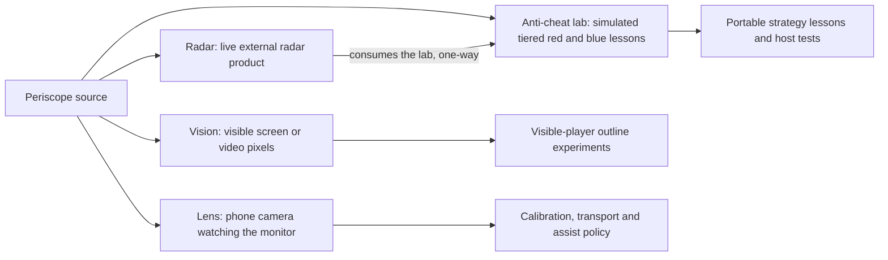

# Periscope

Periscope contains four independently built and licensed CS2 research
projects: **Anti-Cheat Lab**, a simulation-only tiered red/blue teaching lab;
**Radar**, the game-facing radar product that consumes the lab's libraries;
**Vision**, a pixel-only accessibility research package; and **Lens**, a
camera-only phone track that watches the monitor instead of the pixels. They
share a subject area but no runtime code (radar consumes the anti-cheat lab
one-way). New here? [docs/ARCHITECTURE.md](docs/ARCHITECTURE.md)
shows what runs where, what happens when you run each tool, and where the
code lives.

> _Claude was used to polish and proof-read the code and documentation of this repository._

<details>
<summary>Status and limitations</summary>

Periscope is an independent exploratory research project with separate
anti-cheat teaching-lab, Radar, Vision pixel-based accessibility and Lens
camera tracks. Developed independently alongside my main
professional work. The anti-cheat lab is simulation-only; Radar's real
backends default to off; Vision and Lens are pre-alpha. All are research
scaffolding to review, adapt and test, and their documented experiments do not establish a
reliable live-game product.

**Disclaimer.** Use real backends only within an authorized lab and follow each subtree's
scope restrictions. Pixel-based perception can miss or misidentify visible content; it
provides no guarantee of accessibility or anti-cheat acceptance. You are responsible for any
capture, process access and use under applicable platform rules.

</details>

The four tracks stay separate in both their build and their evidence:



## Projects

| Path | Stack | License | Purpose |
|------|-------|---------|---------|
| [`anti-cheat/`](anti-cheat/) | C++20, CMake | MIT | Simulation-only tiered red/blue teaching lab: T0–T4 external radar scars and counters over a simulated world; the radar product consumes its libraries |
| [`radar/`](radar/) | C++20, CMake | MIT | Game-facing radar product: real adapters, live CS2 reading, web radar and relay (optional Windows real backends behind CMake flags) |
| [`vision/`](vision/) | Python 3.11–3.13, `uv` | AGPL-3.0-only | Pre-alpha package `cs2-vision-access` (CLI `cs2-vision`): outline visible players from screen/video pixels only, including a second-device HDMI capture topology |
| [`lens/`](lens/) | Python 3.11–3.13 + Kotlin companion, `uv` | AGPL-3.0-only | Pre-alpha phone-camera track: a smartphone watches the monitor; calibration, optical preflight, USB target transport and lab-only assist policy |

## Quick start

**Anti-cheat lab** — see [`anti-cheat/README.md`](anti-cheat/README.md). Build from the repository root:

```bash
cmake -S anti-cheat -B anti-cheat/build/dev
cmake --build anti-cheat/build/dev -j
```

**Radar** — see [`radar/README.md`](radar/README.md). Build from the repository root:

```bash
cmake -S radar -B radar/build/dev
cmake --build radar/build/dev -j
```

**Vision** — see [`vision/README.md`](vision/README.md). From `vision/`:

```bash
cd vision
uv venv --python 3.12
uv sync --frozen --extra dev
uv run cs2-vision --help
```

**Lens** — see [`lens/README.md`](lens/README.md). From `lens/`:

```bash
cd lens
uv venv --python 3.12
uv sync --frozen --extra dev
uv run pytest tests/ -q
```

## Layout (monorepo root)

```
.
├── README.md           This file
├── CONTRIBUTING.md     Monorepo contribution rules
├── SECURITY.md         Scope and reporting
├── NOTICE.md           Dual-license and third-party pointers
├── .gitignore          Root ignore union
├── .github/            Path-filtered CI + issue/PR templates
├── anti-cheat/         Anti-cheat lab (MIT)
├── lens/               Phone-camera track (AGPL-3.0-only)
├── radar/              Radar product (MIT)
└── vision/             CS2 Vision Access (AGPL-3.0-only)
```

Each subtree has its own `README`, `LICENSE`, `CONTRIBUTING`, `SECURITY`, and docs tree. Root files do not replace those.

The system map, dependency rules and placement guide are in
[`docs/ARCHITECTURE.md`](docs/ARCHITECTURE.md). Run all portable repository
checks with:

```bash
python3 scripts/verify.py all
```

## Not a cheat product

All four tracks are research / teaching / accessibility scaffolding.

- **anti-cheat** is simulation-only: red plants scars on a simulated world and blue detects them. No real backends, drivers or firmware exist in the tree — see [`anti-cheat/SECURITY.md`](anti-cheat/SECURITY.md).
- **vision** never opens the game process, reads game memory, or injects input. Capture is external pixels (screen, capture device, or local video). The primary live topology puts capture, inference, and the composite on a second machine fed by HDMI, so the gaming PC runs nothing extra — see [`vision/docs/CONTOUR_PIPELINE.md`](vision/docs/CONTOUR_PIPELINE.md).
- **radar** real mode is lab/read-oriented educational scaffolding (process attach, optional kernel/DMA paths under opt-in flags). Real backends default to off. High-risk paths (sample vulnerable driver, DMA firmware examples, elevated real backends) are lab-only — see [`radar/SECURITY.md`](radar/SECURITY.md).

Operators own compliance with platform terms, anti-cheat policy, and local law.

## Docs and policy

| Doc | Role |
|-----|------|
| [CONTRIBUTING.md](CONTRIBUTING.md) | Monorepo PR rules and verification commands |
| [docs/ARCHITECTURE.md](docs/ARCHITECTURE.md) | Newcomer map: overview, run paths, CI, code map, dependency rules |
| [SECURITY.md](SECURITY.md) | Reporting and scope |
| [NOTICE.md](NOTICE.md) | Dual licensing |
| [lens/README.md](lens/README.md) · [lens/docs/TOPOLOGY.md](lens/docs/TOPOLOGY.md) | Lens build, topology and output support |
| [anti-cheat/README.md](anti-cheat/README.md) · [anti-cheat/docs/INDEX.md](anti-cheat/docs/INDEX.md) | Anti-cheat lab curriculum and build |
| [radar/README.md](radar/README.md) · [radar/docs/INDEX.md](radar/docs/INDEX.md) | Radar product overview and build |
| [vision/README.md](vision/README.md) · [vision/docs/](vision/docs/) | Vision install, CLI, architecture |
| [vision/docs/CONTOUR_PIPELINE.md](vision/docs/CONTOUR_PIPELINE.md) | Second-device contour composite (HDMI capture card) |
| [anti-cheat/CONTRIBUTING.md](anti-cheat/CONTRIBUTING.md) · [radar/CONTRIBUTING.md](radar/CONTRIBUTING.md) · [vision/CONTRIBUTING.md](vision/CONTRIBUTING.md) | Per-project contribution detail |
| [anti-cheat/SECURITY.md](anti-cheat/SECURITY.md) · [radar/SECURITY.md](radar/SECURITY.md) · [vision/SECURITY.md](vision/SECURITY.md) | Per-project security notes |

## Licensing

There is **no** single monorepo license. Each subtree keeps its own:

- `anti-cheat/` — MIT (`anti-cheat/LICENSE`)
- `radar/` — MIT (`radar/LICENSE`)
- `vision/` — AGPL-3.0-only (`vision/LICENSE`); third-party notes in `vision/NOTICE.md` and [NOTICE.md](NOTICE.md)
- `lens/` — AGPL-3.0-only (`lens/LICENSE`); third-party notes in `lens/NOTICE.md`

Code or docs that sit only at the monorepo root (these policy files) are dual-applicable packaging; when in doubt, treat shared root text as documentation, not a relicense of either tree.
