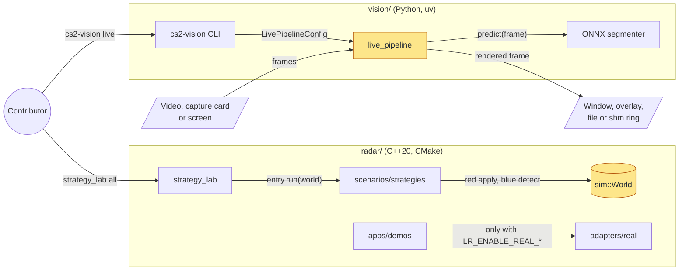
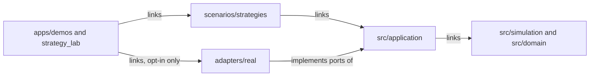
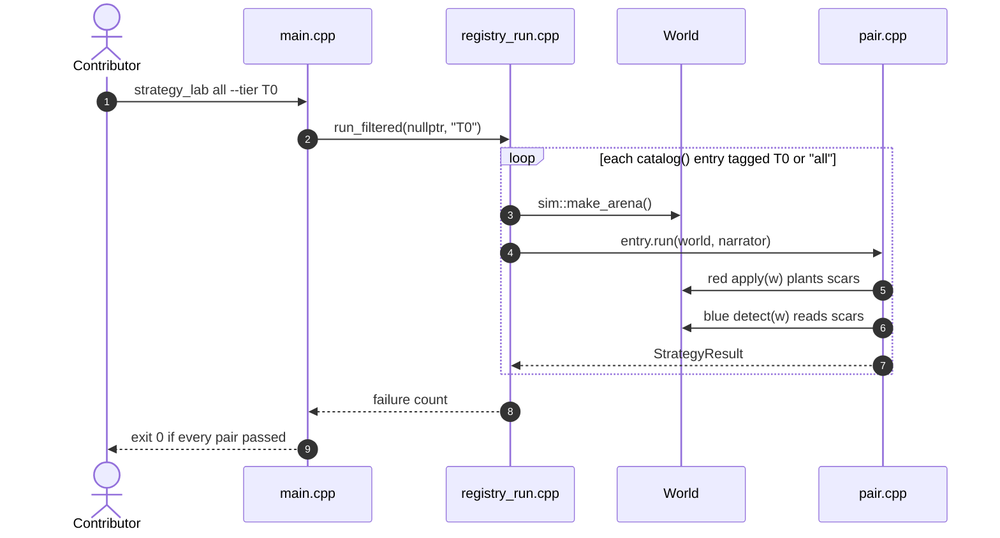
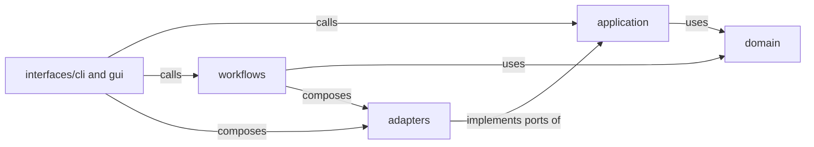
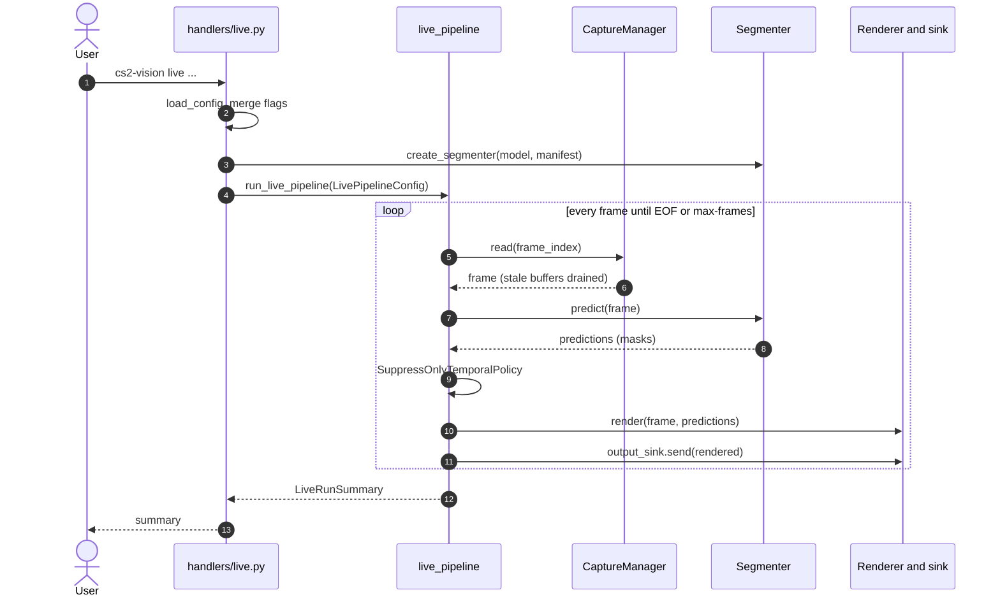
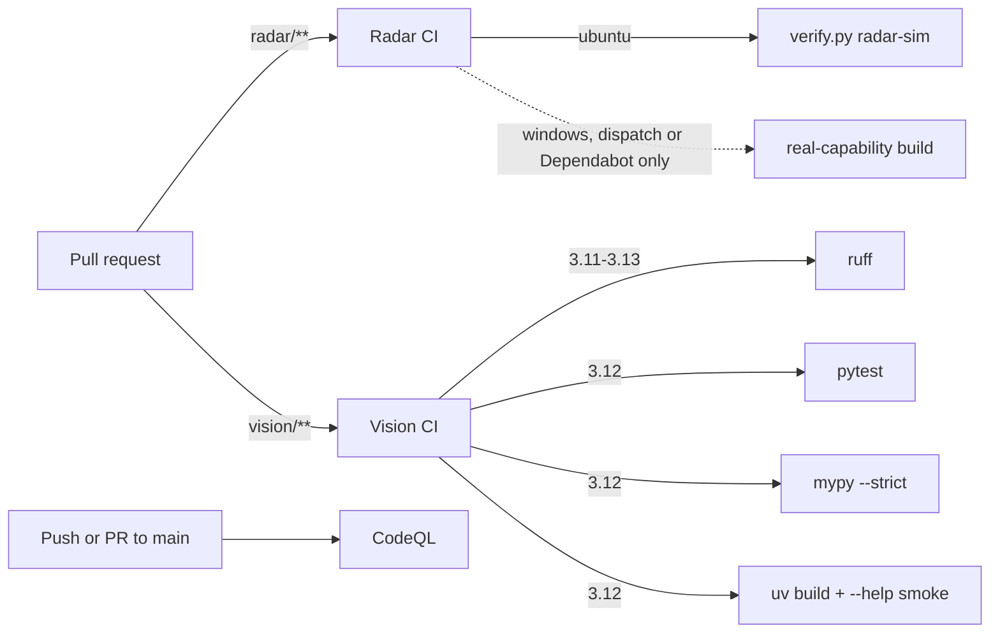

# Architecture

Periscope is an umbrella repository, not a single application. It contains two
independently licensed and independently built research products that share a
subject area but no runtime code ([decision 0001](decisions/0001-independent-products.md)):

- **Radar** (`radar/`, C++20, MIT) is a red/blue teaching lab. It runs
  in a deterministic simulation by default. Each "strategy pair" plants an
  attack trace in a simulated world, then scores whether the matching
  detection catches it.
- **Vision** (`vision/`, Python, AGPL-3.0-only) is a pixel-only accessibility
  package. It reads frames from a video, capture device or screen, segments
  visible players with an ONNX model and draws outlines.

This page is the newcomer's map: what runs where, what happens when you run
each tool, and where the code lives. Per-project detail stays in
[radar/docs/ARCHITECTURE.md](../radar/docs/ARCHITECTURE.md) and
[vision/docs/ARCHITECTURE.md](../vision/docs/ARCHITECTURE.md).

## System overview

What is in the repository, and what does each part run?

No arrow crosses between the two subgraphs. That is intentional: no Radar
target includes or links Vision, and no Vision module imports Radar.
The default Radar build never compiles `real`: every real-platform backend sits
behind its own `LR_ENABLE_REAL_*` CMake option (all `OFF`), and the
`strategy_lab` you get from a default build refuses `attach` and `mode real`. Vision never opens the game process. Its only input is
pixels.

**Where in the code**

- [radar/CMakeLists.txt](../radar/CMakeLists.txt) and [radar/cmake/Options.cmake](../radar/cmake/Options.cmake): build entry and opt-in flags
- [radar/scenarios/strategies/framework/main.cpp](../radar/scenarios/strategies/framework/main.cpp): `strategy_lab` CLI
- [radar/src/simulation/sim/world.hpp](../radar/src/simulation/sim/world.hpp): `sim::World`, the single source of truth for the lab
- [vision/pyproject.toml](../vision/pyproject.toml): `cs2-vision` → `cs2_vision_access.cli:main`
- [vision/src/cs2_vision_access/adapters/capture/live_pipeline/](../vision/src/cs2_vision_access/adapters/capture/live_pipeline/): the frame loop

## How it runs

| | Radar | Vision |
| --- | --- | --- |
| Process | Short-lived native executables (`strategy_lab`, `duel_tN`, `proto_tN_*`, `radar_tN`, …) | One Python process per `cs2-vision` command |
| Build | `cmake -S radar -B radar/build/dev` | `uv sync --frozen --extra dev` in `vision/` |
| State | In memory only: a fresh `sim::World` per pair run | Config file, ONNX models + manifests, datasets and artifacts on disk |
| Output | Console narrative and exit code | Display window, overlay, video file, or `shm:<name>` ring |
| Default | Simulation, no game process needed | ONNX Runtime on CPU, CUDA optional. The HDMI second-device presenter is Windows-only |

The Vision presenter for the second-device setup has its own guide,
[vision/docs/CONTOUR_PIPELINE.md](../vision/docs/CONTOUR_PIPELINE.md).

## Radar: layers

Which Radar code may depend on which?

Executables are the composition roots: `lr_exe` in `radar/CMakeLists.txt`
adds `adapters/` to every executable's include path, and reusable library
targets never receive it. The reverse
direction is forbidden: `src/domain` and `src/simulation` never include a real
adapter. The real Windows, Linux, kernel, DMA, VMX, SMM, UEFI, GPU, network,
driver and firmware lanes are teaching material, never part of the default
simulation graph, and remain explicit build and runtime opt-ins.

**Where in the code**

- [radar/cmake/AppTargets.cmake](../radar/cmake/AppTargets.cmake): which executable links which library
- [radar/cmake/ScenarioTargets.cmake](../radar/cmake/ScenarioTargets.cmake), [radar/cmake/SimulationTargets.cmake](../radar/cmake/SimulationTargets.cmake), [radar/cmake/RealTargets.cmake](../radar/cmake/RealTargets.cmake): the library graph
- [radar/docs/ARCHITECTURE.md](../radar/docs/ARCHITECTURE.md): the full target table

## Radar: what happens when you run the lab

What does `strategy_lab all --tier T0` actually do?

A pair passes when blue detected or mitigated the scar, or when red never
achieved its goal (steps 5 to 7). Each run gets a fresh world from step 3, so
pairs cannot leak state into each other. `strategy_lab run <id>` takes the same
path through `run_dual` in `registry_dual.cpp`. In a default build it runs only
the simulation half. Each pair directory also holds a `LESSON.md` explaining
the scenario.

**Where in the code**

- [radar/scenarios/strategies/framework/main.cpp](../radar/scenarios/strategies/framework/main.cpp): argument parsing and dispatch
- [radar/scenarios/strategies/framework/registry_run.cpp](../radar/scenarios/strategies/framework/registry_run.cpp): `run_one`, `run_all`, `run_filtered`
- [radar/src/application/strategies/framework.hpp](../radar/src/application/strategies/framework.hpp): `StrategyMeta`, `StrategyResult`, `StrategyEntry`
- [radar/scenarios/strategies/t0/accept_readiness_gate/](../radar/scenarios/strategies/t0/accept_readiness_gate/): one complete pair (`pair.cpp`, `red_example.cpp`, `blue_example.cpp`, `LESSON.md`)
- [radar/scenarios/strategies/CATALOG.md](../radar/scenarios/strategies/CATALOG.md): the pair catalog

## Vision: layers

Which Vision code may depend on which?

The CLI and GUI are composition edges. Shared behaviour belongs in
`application`, deterministic schemas and value objects in `domain`, and every
effect (capture, ONNX Runtime, OpenCV drawing, Win32 windows, shared memory) in
`adapters`. `domain` and `application` never import `workflows`, `interfaces`
or a concrete adapter. A batch workflow may keep a one-off filesystem or
OpenCV call local when a port would add no useful test seam. Capture
reconnect/backoff and the stale-frame bound live in the capture adapter, never
in the live loop. Top-level packages such as `cli/` and `segmenters/` are
small compatibility facades for older import paths, not new code locations.

**Where in the code**

- [vision/src/cs2_vision_access/interfaces/cli/parser.py](../vision/src/cs2_vision_access/interfaces/cli/parser.py) and [handlers/](../vision/src/cs2_vision_access/interfaces/cli/handlers/): one module per command group
- [vision/src/cs2_vision_access/application/ports/](../vision/src/cs2_vision_access/application/ports/): the ports adapters implement
- [vision/docs/ARCHITECTURE.md](../vision/docs/ARCHITECTURE.md): the package map

## Vision: what happens when you run `live`

What happens to one frame after `cs2-vision live --source-type file --input-device clip.mp4 --model model.onnx --headless --output-sink out.mp4`?

Explicit flags beat the config file (step 2). Segmenters that require a
manifest check the model file's SHA-256 against it when they load (step 3). The
temporal policy (step 9) drops detections that do not persist across frames
and can hold the last seen outline for a few frames across a dropout. It never
invents an outline the model did not produce. The same loop serves screen capture,
an HDMI capture card, a desktop window, a transparent overlay
(`--overlay`) and the shared-memory ring (`--output-stream shm:<name>`). Only
the capture source and the sink change.

**Where in the code**

- [vision/src/cs2_vision_access/interfaces/cli/handlers/live.py](../vision/src/cs2_vision_access/interfaces/cli/handlers/live.py): `_handle_live`, `_resolve_capture_source`, `_build_segmenter`
- [vision/src/cs2_vision_access/adapters/capture/live_pipeline/runner.py](../vision/src/cs2_vision_access/adapters/capture/live_pipeline/runner.py) and [frame.py](../vision/src/cs2_vision_access/adapters/capture/live_pipeline/frame.py): `run_live_pipeline`, `run_frame`
- [vision/src/cs2_vision_access/adapters/capture/manager.py](../vision/src/cs2_vision_access/adapters/capture/manager.py): `CaptureManager` (fourcc negotiation, reconnect backoff)
- [vision/src/cs2_vision_access/adapters/models/segmenters/factory.py](../vision/src/cs2_vision_access/adapters/models/segmenters/factory.py): `create_segmenter` and backend selection
- [vision/src/cs2_vision_access/application/live/inference/temporal.py](../vision/src/cs2_vision_access/application/live/inference/temporal.py): `SuppressOnlyTemporalPolicy`
- [vision/src/cs2_vision_access/adapters/capture/sinks/shared.py](../vision/src/cs2_vision_access/adapters/capture/sinks/shared.py): `SharedFrameSink`, `read_shared_frame`

The other commands (offline `outline`, `benchmark`, dataset, labeling,
training, study and `bakeoff`) are batch workflows under `workflows/`. See
[vision/docs/CLI.md](../vision/docs/CLI.md).

## Build and verification

How is a change checked?

`scripts/verify.py` runs the same checks locally:
`python3 scripts/verify.py architecture|radar-sim|vision-cpu|all`. `radar-sim`
configures, builds, runs `ctest`, then runs `strategy_lab list` and
`strategy_lab all --quiet`. Every pair must pass. `vision-cpu` runs pytest.
CodeQL also runs weekly on a schedule.
The portable jobs run on every pull request that touches their paths. The
Windows job runs only on manual `workflow_dispatch` or Dependabot pull requests
(dotted edge). It only proves that the documented real
capability combination still compiles. It never runs it. Neither project
publishes a release artifact.

**Where in the code**

- [scripts/verify.py](../scripts/verify.py), [scripts/check_architecture.py](../scripts/check_architecture.py)
- [.github/workflows/radar-ci.yml](../.github/workflows/radar-ci.yml), [.github/workflows/vision-ci.yml](../.github/workflows/vision-ci.yml), [.github/workflows/security.yml](../.github/workflows/security.yml)

## Code map

Read in this order:

| Path | Responsibility |
| --- | --- |
| [README.md](../README.md), [docs/decisions/](decisions/) | What the two projects are and why they stay separate |
| [radar/README.md](../radar/README.md), [radar/docs/INDEX.md](../radar/docs/INDEX.md) | Radar curriculum, tiers T0–T4, build |
| [radar/src/simulation/sim/](../radar/src/simulation/sim/) | `sim::World` and its scar fields |
| [radar/src/application/strategies/](../radar/src/application/strategies/) | Pair contracts and shared detection helpers |
| [radar/scenarios/strategies/](../radar/scenarios/strategies/) | `strategy_lab` and every red/blue pair, by tier |
| [radar/src/lab_components/teams/](../radar/src/lab_components/teams/) | Per-tier team libraries used by `duel_tN` and `proto_tN_*` |
| [radar/apps/demos/](../radar/apps/demos/) | Runnable executables (composition roots) |
| [radar/adapters/real/](../radar/adapters/real/) | Opt-in platform backends, see [radar/SECURITY.md](../radar/SECURITY.md) |
| [vision/README.md](../vision/README.md), [vision/docs/CLI.md](../vision/docs/CLI.md) | Vision install and commands |
| [vision/src/cs2_vision_access/domain/](../vision/src/cs2_vision_access/domain/) | Predictions, styles, manifests, dataset schemas |
| [vision/src/cs2_vision_access/application/](../vision/src/cs2_vision_access/application/) | Config, model assets, ports, temporal policy |
| [vision/src/cs2_vision_access/adapters/](../vision/src/cs2_vision_access/adapters/) | Capture, model runtimes, rendering, presenter |
| [vision/src/cs2_vision_access/workflows/](../vision/src/cs2_vision_access/workflows/) | Dataset, labeling, training, evaluation, study, bakeoff |
| [vision/src/cs2_vision_access/interfaces/](../vision/src/cs2_vision_access/interfaces/) | CLI and Tk GUI |
| [scripts/](../scripts/) | Repository-wide verification |

## External contracts

- Vision preserves the `cs2-vision-access` distribution, `cs2-vision` command,
  `python -m cs2_vision_access`, documented public imports, backend names,
  configuration and artifact schemas, model checksum binding, and pixel-only
  safety boundary.
- Radar preserves documented executable and CMake option names, simulation as
  the default, strategy-lab commands, offset snapshot formats, and versioned
  driver, firmware, IPC, and network layouts.
- Source-tree module names, private helpers, CMake library decomposition, and
  directory locations are internal unless active documentation says otherwise.

## Placement guide

- Put deterministic concepts and policies in `domain` or `simulation`.
- Put use-case sequencing in `application` or `workflows`.
- Put OS, hardware, model-runtime, network, UI-toolkit, and filesystem effects
  in adapters or interfaces.
- Put executable and command composition at the outer edge.
- Add a shared abstraction only for a real boundary with more than one useful
  implementation or a test substitute.

`python3 scripts/check_architecture.py` enforces the dependency rules that are
cheap and valuable to check mechanically.
