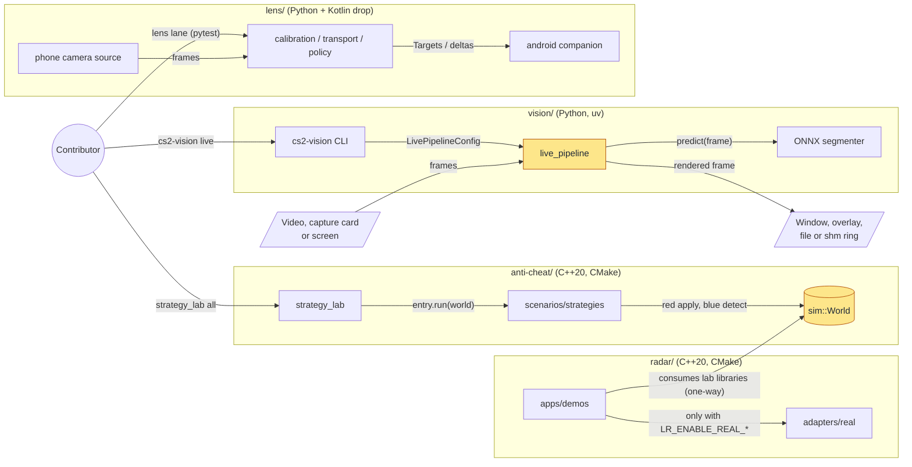
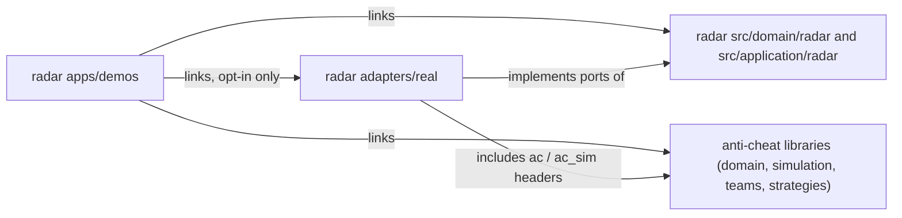
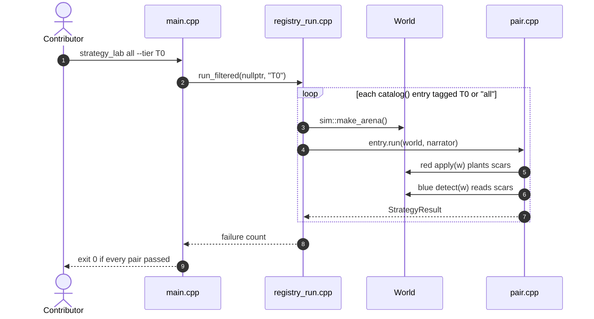
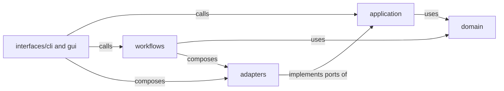
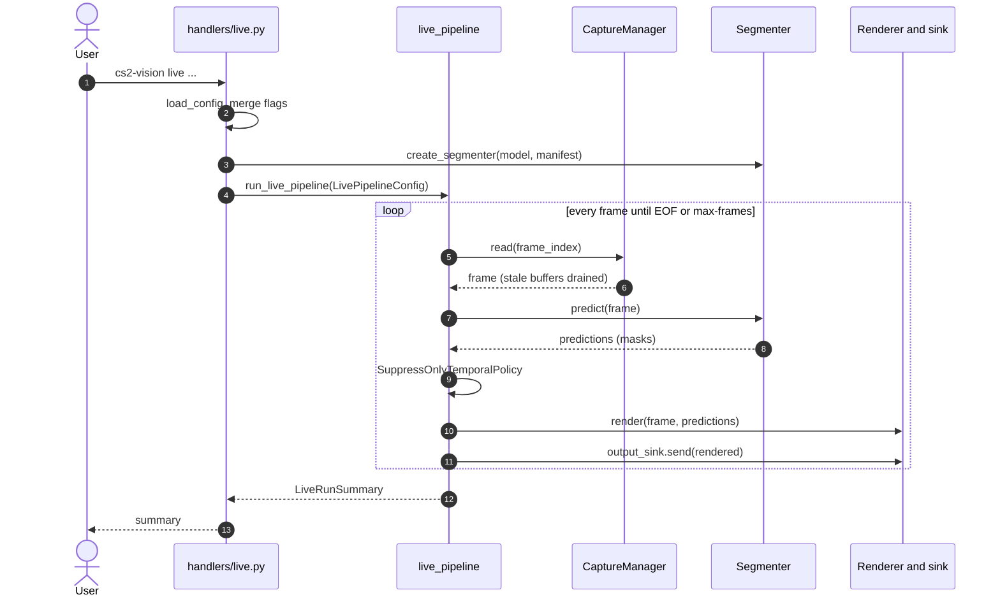
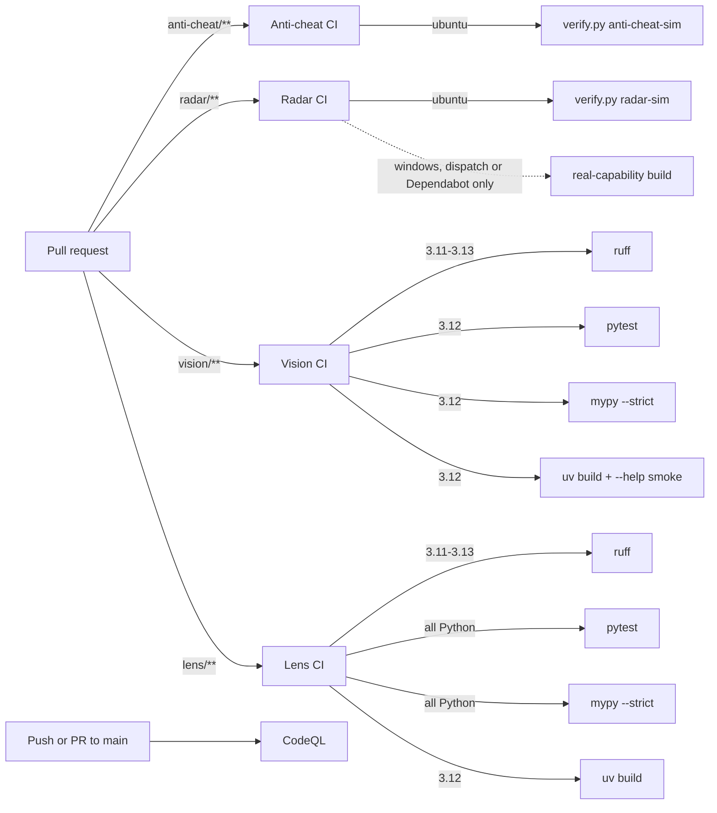

# Architecture

Periscope is an umbrella repository, not a single application. It contains
four independently licensed and independently built research products that
share a subject area but no runtime code
([decision 0001](decisions/0001-independent-products.md)):

- Anti-Cheat Lab (`anti-cheat/`, C++20, MIT) is a simulation-only
  red/blue teaching lab. Each "strategy pair" plants an attack trace in a
  deterministic simulated world, then scores whether the matching detection
  catches it. It owns `sim::World` and the tier curriculum.
- Radar (`radar/`, C++20, MIT) is the game-facing product: real adapters,
  live CS2 reading, the web radar and the relay. It consumes the anti-cheat
  lab's libraries one-way.
- Vision (`vision/`, Python, AGPL-3.0-only) is a pixel-only accessibility
  package. It reads frames from a video, capture device or screen, segments
  visible players with an ONNX model and draws outlines.
- Lens (`lens/`, Python + Kotlin companion, AGPL-3.0-only) is a
  camera-only phone track: a smartphone pointed at the monitor supplies the
  pixels; portable modules cover calibration, optical preflight, USB target
  transport, latency compensation and lab-only output shaping.

This page is the newcomer's map: what runs where, what happens when you run
each tool, and where the code lives. Per-project detail stays in
[anti-cheat/README.md](../anti-cheat/README.md),
[radar/docs/ARCHITECTURE.md](../radar/docs/ARCHITECTURE.md),
[vision/docs/ARCHITECTURE.md](../vision/docs/ARCHITECTURE.md) and
[lens/docs/TOPOLOGY.md](../lens/docs/TOPOLOGY.md).

## System overview

What is in the repository, and what does each part run?

The only arrow that crosses between the C++ subgraphs is the one-way radar →
anti-cheat edge: radar consumes the lab's libraries (types, world, teams,
strategies), and the lab never imports radar code. No Radar target includes or
links Vision or Lens, and neither Python package imports Radar or the lab. The default Radar build never
compiles `real`: every real-platform backend sits behind its own
`LR_ENABLE_REAL_*` CMake option (all `OFF`). Vision never opens the game
process. Its only input is pixels. The `strategy_lab` you get from a default
lab build refuses `attach` and `mode real`.

Where in the code

- [anti-cheat/CMakeLists.txt](../anti-cheat/CMakeLists.txt) and [radar/CMakeLists.txt](../radar/CMakeLists.txt): the two build entries; radar points at the lab via `LR_ANTI_CHEAT_DIR`
- [radar/cmake/Options.cmake](../radar/cmake/Options.cmake): the opt-in real flags
- [anti-cheat/scenarios/strategies/framework/main.cpp](../anti-cheat/scenarios/strategies/framework/main.cpp): `strategy_lab` CLI
- [anti-cheat/src/simulation/sim/world.hpp](../anti-cheat/src/simulation/sim/world.hpp): `sim::World`, the single source of truth for the lab
- [vision/pyproject.toml](../vision/pyproject.toml): `cs2-vision` → `cs2_vision_access.cli:main`
- [lens/pyproject.toml](../lens/pyproject.toml): the `periscope_lens` package (library only; no CLI yet)
- [vision/src/cs2_vision_access/adapters/capture/live_pipeline/](../vision/src/cs2_vision_access/adapters/capture/live_pipeline/): the frame loop

## How it runs

| | Anti-cheat lab / Radar | Vision | Lens |
| --- | --- | --- | --- |
| Process | Short-lived native executables (`strategy_lab`, `duel_tN`, `proto_tN_*` in the lab; `radar_tN`, `live_radar`, `radar_diag`, … in radar) | One Python process per `cs2-vision` command | `pytest` (library; Android drop is not run) |
| Build | `cmake -S anti-cheat -B anti-cheat/build/dev` and `cmake -S radar -B radar/build/dev` | `uv sync --frozen --extra dev` in `vision/` | `uv sync --frozen --extra dev` in `lens/` |
| State | In memory only: a fresh `sim::World` per pair run | Config file, ONNX models + manifests, datasets and artifacts on disk | Unit-test state only: the portable core is unit-tested, no hardware state |
| Output | Console narrative and exit code | Display window, overlay, video file, or `shm:<name>` ring | Pytest results; output shaping and policy are library code, not a live product |
| Default | Simulation; radar's real backends are opt-in | ONNX Runtime on CPU, CUDA optional. The HDMI second-device presenter is Windows-only | Camera-only; end-to-end live operation is not claimed |

The Vision presenter for the second-device setup has its own guide,
[vision/docs/CONTOUR_PIPELINE.md](../vision/docs/CONTOUR_PIPELINE.md).

## Radar and the anti-cheat lab: layers

Which Radar and anti-cheat code may depend on which?

Executables are the composition roots: `lr_exe` in `radar/CMakeLists.txt`
adds `adapters/` to every executable's include path, and reusable library
targets never receive it. The reverse
direction is forbidden: radar's `src/domain/radar` never includes a real
adapter, and the anti-cheat lab never imports radar code at all - the single
exception is the lab's `tests/stack_posture_test.cpp`, which reads radar's
`real/cs2/posture.hpp` through a test-only include path (`LR_RADAR_DIR`).
The real Windows, Linux, kernel, DMA, VMX, SMM, UEFI, GPU, network,
driver and firmware lanes are teaching material, never part of the default
simulation graph, and remain explicit build and runtime opt-ins.

Where in the code

- [radar/cmake/AppTargets.cmake](../radar/cmake/AppTargets.cmake): which executable links which library
- [anti-cheat/cmake/ScenarioTargets.cmake](../anti-cheat/cmake/ScenarioTargets.cmake), [anti-cheat/cmake/SimulationTargets.cmake](../anti-cheat/cmake/SimulationTargets.cmake), [radar/cmake/RealTargets.cmake](../radar/cmake/RealTargets.cmake): the library graph
- [radar/docs/ARCHITECTURE.md](../radar/docs/ARCHITECTURE.md): the full target table

## Anti-cheat lab: what happens when you run the lab

What does `strategy_lab all --tier T0` actually do?

A pair passes when blue detected or mitigated the scar, or when red never
achieved its goal (steps 5 to 7). Each run gets a fresh world from step 3, so
pairs cannot leak state into each other. `strategy_lab run <id>` takes the same
path through `run_dual` in `registry_dual.cpp`. In a default build it runs only
the simulation half. Each pair directory also holds a `LESSON.md` explaining
the scenario.

Where in the code

- [anti-cheat/scenarios/strategies/framework/main.cpp](../anti-cheat/scenarios/strategies/framework/main.cpp): argument parsing and dispatch
- [anti-cheat/scenarios/strategies/framework/registry_run.cpp](../anti-cheat/scenarios/strategies/framework/registry_run.cpp): `run_one`, `run_all`, `run_filtered`
- [anti-cheat/src/application/strategies/framework.hpp](../anti-cheat/src/application/strategies/framework.hpp): `StrategyMeta`, `StrategyResult`, `StrategyEntry`
- [anti-cheat/scenarios/strategies/t0/accept_readiness_gate/](../anti-cheat/scenarios/strategies/t0/accept_readiness_gate/): one complete pair (`pair.cpp`, `red_example.cpp`, `blue_example.cpp`, `LESSON.md`)
- [anti-cheat/scenarios/strategies/CATALOG.md](../anti-cheat/scenarios/strategies/CATALOG.md): the pair catalog

## Vision: layers

Which Vision code may depend on which?

The CLI and GUI are composition edges. Shared behaviour belongs in
`application`, deterministic schemas and value objects in `domain`, and every
effect (capture, ONNX Runtime, OpenCV drawing, Win32 windows, shared memory) in
`adapters`. `domain` and `application` never import `workflows`, `interfaces`
or a concrete adapter. A batch workflow may keep a one-off filesystem or
OpenCV call local when a port would add no useful test seam. Capture
reconnect/backoff and the stale-frame bound live in the capture adapter, never
in the live loop. Top-level packages such as `cli/` and `segmenters/` are
small compatibility facades for older import paths, not new code locations.

Where in the code

- [vision/src/cs2_vision_access/interfaces/cli/parser.py](../vision/src/cs2_vision_access/interfaces/cli/parser.py) and [handlers/](../vision/src/cs2_vision_access/interfaces/cli/handlers/): one module per command group
- [vision/src/cs2_vision_access/application/ports/](../vision/src/cs2_vision_access/application/ports/): the ports adapters implement
- [vision/docs/ARCHITECTURE.md](../vision/docs/ARCHITECTURE.md): the package map

## Vision: what happens when you run `live`

What happens to one frame after `cs2-vision live --source-type file --input-device clip.mp4 --model model.onnx --headless --output-sink out.mp4`?

Explicit flags beat the config file (step 2). Segmenters that require a
manifest check the model file's SHA-256 against it when they load (step 3). The
temporal policy (step 9) drops detections that do not persist across frames
and can hold the last seen outline for a few frames across a dropout. It never
invents an outline the model did not produce. The same loop serves screen capture,
an HDMI capture card, a desktop window, a transparent overlay
(`--overlay`) and the shared-memory ring (`--output-stream shm:<name>`). Only
the capture source and the sink change.

Where in the code

- [vision/src/cs2_vision_access/interfaces/cli/handlers/live.py](../vision/src/cs2_vision_access/interfaces/cli/handlers/live.py): `_handle_live`, `_resolve_capture_source`, `_build_segmenter`
- [vision/src/cs2_vision_access/adapters/capture/live_pipeline/runner.py](../vision/src/cs2_vision_access/adapters/capture/live_pipeline/runner.py) and [frame.py](../vision/src/cs2_vision_access/adapters/capture/live_pipeline/frame.py): `run_live_pipeline`, `run_frame`
- [vision/src/cs2_vision_access/adapters/capture/manager.py](../vision/src/cs2_vision_access/adapters/capture/manager.py): `CaptureManager` (fourcc negotiation, reconnect backoff)
- [vision/src/cs2_vision_access/adapters/models/segmenters/factory.py](../vision/src/cs2_vision_access/adapters/models/segmenters/factory.py): `create_segmenter` and backend selection
- [vision/src/cs2_vision_access/application/live/inference/temporal.py](../vision/src/cs2_vision_access/application/live/inference/temporal.py): `SuppressOnlyTemporalPolicy`
- [vision/src/cs2_vision_access/adapters/capture/sinks/shared.py](../vision/src/cs2_vision_access/adapters/capture/sinks/shared.py): `SharedFrameSink`, `read_shared_frame`

The other commands (offline `outline`, `benchmark`, dataset, labeling,
training, study and `bakeoff`) are batch workflows under `workflows/`. See
[vision/docs/CLI.md](../vision/docs/CLI.md).

## Build and verification

How is a change checked?

`scripts/verify.py` runs the same checks locally:
`python3 scripts/verify.py architecture|anti-cheat-sim|radar-sim|vision-cpu|lens-cpu|all`.
`anti-cheat-sim` configures and builds the lab, runs its ctest, then runs
`strategy_lab all --quiet`.
`radar-sim` configures, builds, runs `ctest`, then runs `strategy_lab list`
and `strategy_lab all --quiet` from the radar lane. Every pair must pass.
`vision-cpu` and `lens-cpu` run their own package checks and pytest lanes.
CodeQL also runs weekly on a schedule.
The portable jobs run on every pull request that touches their paths. The
Windows job runs only on manual `workflow_dispatch` or Dependabot pull requests
(dotted edge). It only proves that the documented real
capability combination still compiles. It never runs it. Neither native
project publishes a release artifact; the Python packages are built (not
published) by their lanes.

Where in the code

- [scripts/verify.py](../scripts/verify.py), [scripts/check_architecture.py](../scripts/check_architecture.py)
- [.github/workflows/anti-cheat-ci.yml](../.github/workflows/anti-cheat-ci.yml), [.github/workflows/radar-ci.yml](../.github/workflows/radar-ci.yml), [.github/workflows/vision-ci.yml](../.github/workflows/vision-ci.yml), [.github/workflows/lens-ci.yml](../.github/workflows/lens-ci.yml), [.github/workflows/security.yml](../.github/workflows/security.yml)

## Code map

Read in this order:

| Path | Responsibility |
| --- | --- |
| [README.md](../README.md), [docs/decisions/](decisions/) | What the four projects are and why they stay separate |
| [anti-cheat/README.md](../anti-cheat/README.md), [anti-cheat/docs/INDEX.md](../anti-cheat/docs/INDEX.md) | Lab curriculum, tiers T0–T4, build |
| [anti-cheat/src/simulation/sim/](../anti-cheat/src/simulation/sim/) | `sim::World` and its scar fields |
| [anti-cheat/src/application/strategies/](../anti-cheat/src/application/strategies/) | Pair contracts and shared detection helpers |
| [anti-cheat/scenarios/strategies/](../anti-cheat/scenarios/strategies/) | `strategy_lab` and every red/blue pair, by tier |
| [anti-cheat/src/lab_components/teams/](../anti-cheat/src/lab_components/teams/) | Per-tier team libraries used by `duel_tN` and `proto_tN_*` |
| [radar/README.md](../radar/README.md), [radar/docs/INDEX.md](../radar/docs/INDEX.md) | Radar product overview, docs and build |
| [radar/src/domain/radar/](../radar/src/domain/radar/) | Radar product modules: snapshot, sampling, projection, scatter, mini-radar |
| [radar/src/application/radar/](../radar/src/application/radar/) | Web radar service and tri_loader |
| [radar/apps/demos/](../radar/apps/demos/) | Runnable executables (composition roots) |
| [radar/adapters/real/](../radar/adapters/real/) | Opt-in platform backends, see [radar/SECURITY.md](../radar/SECURITY.md) |
| [vision/README.md](../vision/README.md), [vision/docs/CLI.md](../vision/docs/CLI.md) | Vision install and commands |
| [vision/src/cs2_vision_access/domain/](../vision/src/cs2_vision_access/domain/) | Predictions, styles, manifests, dataset schemas |
| [vision/src/cs2_vision_access/application/](../vision/src/cs2_vision_access/application/) | Config, model assets, ports, temporal policy |
| [vision/src/cs2_vision_access/adapters/](../vision/src/cs2_vision_access/adapters/) | Capture, model runtimes, rendering, presenter |
| [vision/src/cs2_vision_access/workflows/](../vision/src/cs2_vision_access/workflows/) | Dataset, labeling, training, evaluation, study, bakeoff |
| [vision/src/cs2_vision_access/interfaces/](../vision/src/cs2_vision_access/interfaces/) | CLI and Tk GUI |
| [lens/README.md](../lens/README.md), [lens/docs/TOPOLOGY.md](../lens/docs/TOPOLOGY.md) | Lens install, topology and output support |
| [lens/src/periscope_lens/](../lens/src/periscope_lens/) | Portable calibration, preflight, transport, latency, output and policy core |
| [lens/android/](../lens/android/) | Kotlin companion source drop |
| [scripts/](../scripts/) | Repository-wide verification |

## External contracts

- Vision preserves the `cs2-vision-access` distribution, `cs2-vision` command,
  `python -m cs2_vision_access`, documented public imports, backend names,
  configuration and artifact schemas, model checksum binding, and pixel-only
  safety boundary.
- Radar preserves documented executable and CMake option names, real-mode
  opt-in flags, offset snapshot formats, and versioned
  driver, firmware, IPC, and network layouts.
- Anti-cheat keeps simulation as the only mode, the `strategy_lab` commands,
  and the tier curriculum layout.
- Lens preserves the `periscope_lens` package name, the versioned L6 wire
  contract, and the camera-only boundary; the Android drop is not a release
  artifact.
- Source-tree module names, private helpers, CMake library decomposition, and
  directory locations are internal unless active documentation says otherwise.

## Placement guide

- Put deterministic concepts and policies in `domain` or `simulation`.
- Put use-case sequencing in `application` or `workflows`.
- Put OS, hardware, model-runtime, network, UI-toolkit, and filesystem effects
  in adapters or interfaces.
- Put executable and command composition at the outer edge.
- Add a shared abstraction only for a real boundary with more than one useful
  implementation or a test substitute.

`python3 scripts/check_architecture.py` enforces the dependency rules that are
cheap and valuable to check mechanically, plus tracked-file presence and
Markdown link resolution.
